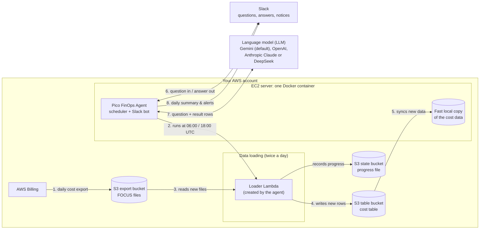

# Pico FinOps Agent: Setup Guide

The **Pico FinOps Agent** is an assistant for your AWS costs. You can ask it questions in Slack, for example:

> **@Pico FinOps Agent** what did I spend on AWS in October?
> **@Pico FinOps Agent** which service grew the most this week?

It also keeps an eye on your costs. Twice a day it posts what changed, and it warns you about sudden increases.

**Your data stays in your AWS account.** The agent runs on one EC2 server in your account. It reads your AWS billing export and keeps its copy of the data in your own S3. It doesn't need any Pico FinOps servers or a database, and nothing is sent to Pico FinOps.

---

## How it works

### Architecture

Everything inside the dashed box runs **in your own AWS account**. The only things outside it are Slack, where people
ask questions, and the language model (LLM) that writes the answers: Google Gemini by default, or OpenAI,
Anthropic Claude or DeepSeek if you choose one of those.



> If the diagram above doesn't render where you're reading this, here is the same flow in plain text:
>
> ```
>  AWS Billing ─(daily)─► S3 export bucket ─► Loader Lambda ─► S3 table ─► Agent on EC2 (local copy)
>                                               │                               ▲   │
>                                               └─► S3 state bucket             │   ├─► LLM (Gemini by default)
>                                                   (progress file)             │   │
>                                                                   Slack ◄─────┴───┘
>                                                          (questions, answers, notices)
> ```

### How the data flows

**A. Loading the cost data** (automatic, twice a day):
1. **AWS Billing** writes your cost data (the **FOCUS** export) into your **S3 export bucket** once a day.
2. At **06:00 and 18:00 UTC**, the agent on the EC2 starts its **loader Lambda** function.
3. The Lambda reads only the **new** export files. The **progress file** in the state bucket tells it what it has already loaded.
4. It writes the new rows into the **cost table** in your S3 table bucket, then updates the progress file.
5. The agent copies the new data from the cost table into its **fast local copy** on the EC2.
6. The agent posts a 📊 **summary** in Slack: yesterday's cost vs. usual, the month so far, and any sudden increases.

**B. Answering a question** (whenever someone asks):
1. Someone @mentions the agent in Slack, or sends it a direct message.
2. The agent gets the message over an **outgoing** connection to Slack. No port is open on the EC2.
3. The agent asks the **LLM** (Gemini by default) to turn the question into a query, then runs that query on its **local copy**.
4. The LLM writes a short answer from the result rows. The agent posts it back in Slack.

**What goes where:**

| Data | Stays in your AWS account? |
|---|---|
| Your full cost data (export, cost table, local copy) | ✅ Yes, always |
| AWS credentials | ✅ Yes. The agent uses IAM roles, and no access keys are created |
| A question and the rows that answer it | Sent to the LLM you use (Gemini by default) to write the answer |
| The answer and the notices | Posted to your Slack |
| Anything sent to Pico FinOps | ❌ Nothing |

The agent creates the Lambda function and the cost table **by itself** on its first start. You only prepare the buckets and the permissions below.

---

## Before you start: checklist

| You need | Why |
|---|---|
| An AWS account with admin access for the one-time setup | To create the buckets, the roles and the EC2 |
| A Slack workspace where you can create an app | So the agent can answer in Slack |
| A Gemini API key, from [Google AI Studio](https://aistudio.google.com/) | The agent's language model. The default is `gemini-3.8-flash`. You can switch to OpenAI, Anthropic Claude or DeepSeek; see [Choosing the language model](#choosing-the-language-model-llm) |
| The Pico FinOps Agent image name and tag, from Pico FinOps | For example `cloudpi1/cloudpi:Cloudpi_agent_v1.0.0` |

### How long it takes

The whole setup takes about **30-45 minutes** in total. Roughly:

| Step | What you do | Time |
|---|---|---|
| 1 | Turn on the AWS cost export | ~5 min |
| 2 | Create the two buckets | ~5 min |
| 3 | Get and fill in the permission files | ~5 min |
| 4 | Create the two roles | ~5 min |
| 5 | Create the EC2 server and install Docker | ~10 min |
| 6 | Create the Slack app | ~10 min |
| 7 | Configure and start the agent | ~5 min |
| | **Total** | **~30-45 min** |

After it starts, the agent needs a few more minutes to load your data for the first time, or longer if you have many
months of data.

> **If you don't have a cost export yet:** AWS takes up to **24 hours** to deliver the first one after step 1. You can
> do steps 2-7 in the meantime. The agent loads the first files on its next scheduled run after they arrive, or right away if you ask it
> `set up the cost agent`.

---

## Step 1: Turn on the AWS cost export (FOCUS)

1. Open **AWS Console → Billing and Cost Management → Data Exports → Create**.
2. For **Export type**, choose **FOCUS 1.2** (with AWS columns).
3. Under **Data export storage settings**, choose or create an S3 bucket, for example `acme-cost-export`, and a path prefix, for example `focus`.
4. Save it.

AWS delivers the first data within 24 hours. The files appear under `s3://<export-bucket>/<prefix>/<export-name>/data/`.

Note these down:
- **Export bucket**, e.g. `acme-cost-export`
- **Export prefix**: the path up to and including `data/`, e.g. `focus/acme-focus-export/data/`

---

## Step 2: Create two buckets

Create both in the **same Region** as the EC2 you'll use in step 5.

1. **A table bucket** for the agent's cost table.
   - Go to **S3 → Table buckets → Create table bucket**, e.g. `acme-cost-agent`.
   - Note its **ARN**: `arn:aws:s3tables:<region>:<account-id>:bucket/acme-cost-agent`.
2. **A small private bucket** for the agent's progress file.
   - Go to **S3 → Buckets → Create bucket**, e.g. `acme-cost-agent-state`.
   - Keep "Block all public access" turned on.

The agent creates the table inside the table bucket by itself.

---

## Step 3: Get the permission files

The permission files are in this repo under [`policies/aws/`](../policies/aws/): `ec2-role-policy.json`,
`ec2-role-trust.json`, `loader-role-policy.json` and `loader-role-trust.json`. Copy them, or take them from the
image. On any machine with Docker, run:

```bash
IMAGE=cloudpi1/cloudpi:<tag-from-Pico-FinOps>
mkdir pico-finops-agent-iam && cd pico-finops-agent-iam
for f in ec2-role-policy.json loader-role-policy.json loader-role-trust.json; do  # ec2-role-trust.json: policies/aws/
  docker run --rm --entrypoint cat "$IMAGE" /app/cloudpi_agent/iam/$f > $f
done
```

Fill in your own values. Use the names from steps 1 and 2:

```bash
sed -i -e 's|<region>|us-east-1|g' \
       -e 's|<account-id>|111122223333|g' \
       -e 's|<export-bucket>|acme-cost-export|g' \
       -e 's|<export-prefix>|focus/acme-focus-export/data/|g' \
       -e 's|<table-bucket>|acme-cost-agent|g' \
       -e 's|<state-bucket>|acme-cost-agent-state|g' \
       -e 's|<state-key>|cloudpi-agent/state.json|g' *.json
grep -l '<' *.json || echo "All placeholders filled."
```

---

## Step 4: Create the two roles

**4a. The Lambda role**, which the agent's data loader uses:

```bash
aws iam create-role --role-name cloudpi-agent-loader-role \
  --assume-role-policy-document file://loader-role-trust.json
aws iam put-role-policy --role-name cloudpi-agent-loader-role \
  --policy-name pico-finops-agent-loader --policy-document file://loader-role-policy.json
aws iam attach-role-policy --role-name cloudpi-agent-loader-role \
  --policy-arn arn:aws:iam::aws:policy/service-role/AWSLambdaBasicExecutionRole
```

Note the role's **ARN**: `arn:aws:iam::<account-id>:role/cloudpi-agent-loader-role`.

**4b. The EC2 role**, which the agent itself uses:

```bash
# ec2-role-trust.json (policies/aws/) lets EC2 use the role
aws iam create-role --role-name pico-finops-agent-ec2-role --assume-role-policy-document file://ec2-role-trust.json
aws iam put-role-policy --role-name pico-finops-agent-ec2-role \
  --policy-name pico-finops-agent --policy-document file://ec2-role-policy.json
aws iam create-instance-profile --instance-profile-name pico-finops-agent-ec2-role
aws iam add-role-to-instance-profile --instance-profile-name pico-finops-agent-ec2-role --role-name pico-finops-agent-ec2-role
```

**What these roles allow, in plain words:**
- **The EC2 role:**
  - Manage and run **only** the `cloudpi-agent-loader` Lambda function and its `cloudpi-agent-duckdb` layer.
  - Hand **only** the loader role to Lambda.
  - Read the agent's progress file.
  - **Read** the cost table.
- **The Lambda role:**
  - **Read** your export.
  - Create and **write** the cost table.
  - Read and write the progress file.
  - Write its own logs.
- **Neither role** can touch anything else in your account. No access keys are created or stored anywhere.

> **Is your export bucket encrypted with your own KMS key (SSE-KMS)?** Then also allow `kms:Decrypt` on that key for
> `cloudpi-agent-loader-role`. S3-managed encryption (the default) needs nothing extra.

---

## Step 5: Create the EC2 server

1. **Launch an instance:** Linux (e.g. Amazon Linux 2023 or Ubuntu 24.04), **x86_64**, at least **2 vCPU / 4 GB** (e.g. `t3.medium`). Use the **same Region** as the buckets.
2. **IAM instance profile:** `pico-finops-agent-ec2-role`.
3. **Security group:** **no inbound rules are needed.** Add SSH only if you manage the server that way. The agent only makes outbound HTTPS connections to AWS, Slack and your LLM provider (Google Gemini by default).
4. **Metadata:** set **IMDSv2 required** with **hop limit 1**. Set it explicitly, because some images (e.g. Amazon Linux 2023) default to 2, which would let any other container on the server use the role:
   ```bash
   aws ec2 modify-instance-metadata-options --instance-id <instance-id> \
     --http-tokens required --http-put-response-hop-limit 1
   ```
5. **Install Docker** with the compose plugin, e.g. on Amazon Linux 2023:
   ```bash
   sudo dnf install -y docker && sudo systemctl enable --now docker
   sudo mkdir -p /usr/local/lib/docker/cli-plugins
   sudo curl -sSL https://github.com/docker/compose/releases/latest/download/docker-compose-linux-x86_64 \
     -o /usr/local/lib/docker/cli-plugins/docker-compose && sudo chmod +x /usr/local/lib/docker/cli-plugins/docker-compose
   sudo usermod -aG docker $USER   # log out and back in
   ```

> Use this server **for the Pico FinOps Agent only**, and don't give other people logins on it.

---

## Step 6: Create the Slack app

You can skip this step if you don't want Slack. The agent still loads the data, but there's nobody to answer questions.

1. Go to **[api.slack.com/apps](https://api.slack.com/apps) → Create New App → From scratch**. Name it **Pico FinOps Agent** and pick your workspace.
2. Under **Socket Mode**, turn it **on**. Create the **app-level token** with the scope `connections:write`. It starts with **`xapp-`**.
3. Under **OAuth & Permissions → Bot Token Scopes**, add:
   - `chat:write`
   - `channels:history`
   - `groups:history`
   - `im:history`
   - `reactions:write`
   - `mpim:history` (optional, for group DMs)
4. Under **Event Subscriptions**, turn it **on**. Under **Subscribe to bot events**, add:
   - `message.channels`
   - `message.groups`
   - `message.im`
   - `message.mpim` (optional)
5. Under **App Home**, turn on the **Messages tab** and tick "Allow users to send messages", so people can DM the agent.
6. Under **Install App**, install it to your workspace. Copy the **Bot User OAuth Token**, which starts with **`xoxb-`**.
7. In Slack, create a channel for notices, e.g. **#pico-finops-agent**, and invite the bot: `/invite @Pico FinOps Agent`.

Keep both tokens private: they work like passwords.

---

## Step 7: Configure and start the agent

On the EC2:

```bash
mkdir ~/pico-finops-agent && cd ~/pico-finops-agent
# Put the docker-compose.yml from Pico FinOps in this folder, then:
umask 077                                   # the settings file holds keys: readable by you only
IMAGE=cloudpi1/cloudpi:<tag-from-Pico-FinOps>
cp .env.example .env                        # from this repo (or from the image: /app/cloudpi_agent/.env.example)
nano .env                                   # fill in the values below
```

**Settings in `.env`:**

| Setting | Your value |
|---|---|
| `AGENT_IMAGE_TAG` | The tag from Pico FinOps, e.g. `Cloudpi_agent_v1.0.0` |
| `FOCUS_REGION` | e.g. `us-east-1` |
| `FOCUS_EXPORT_BUCKET` | from step 1, e.g. `acme-cost-export` |
| `FOCUS_EXPORT_PREFIX` | from step 1, ends with `data/` |
| `FOCUS_TABLE_BUCKET_ARN` | from step 2 |
| `FOCUS_STATE_BUCKET` | from step 2, e.g. `acme-cost-agent-state` |
| `FOCUS_LAMBDA_ROLE_ARN` | from step 4a |
| `GEMINI_API_KEY` | your Gemini key (always needed, see below) |
| `SLACK_APP_TOKEN` | `xapp-…` from step 6 |
| `SLACK_BOT_TOKEN` | `xoxb-…` from step 6 |
| `SLACK_NOTIFY_CHANNEL` | `pico-finops-agent` (the channel for notices and alerts) |

### Choosing the language model (LLM)

The agent uses an LLM to understand questions and write the answers. These providers are supported:

| Provider | Setting in `.env` | Get a key from |
|---|---|---|
| **Google Gemini** (default, model `gemini-3.8-flash`) | `GEMINI_API_KEY` | [Google AI Studio](https://aistudio.google.com/) |
| **OpenAI** | `OPENAI_API_KEY` | [platform.openai.com](https://platform.openai.com/api-keys) |
| **Anthropic Claude** | `ANTHROPIC_API_KEY` | [console.anthropic.com](https://console.anthropic.com/) |
| **DeepSeek** | `DEEPSEEK_API_KEY` | [platform.deepseek.com](https://platform.deepseek.com/) |

- **To keep the default:** set only `GEMINI_API_KEY`. Nothing else is needed.
- **To use another provider:** add that provider's key to `.env`, then switch the model with Pico's `/model` command.
- **Keep `GEMINI_API_KEY` set either way.** In this version the agent's start-up check and `check` command always
  test the Gemini key, even if you switch to another provider.
- Whichever provider you use, only the question and the rows that answer it are sent to it.

**Check first** (posts nothing, changes nothing). It checks:
- the AWS role
- the agent's buckets and data
- the Slack tokens
- the Gemini key

Fix any `ALERT:` line it prints before you start:

```bash
docker compose run --rm agent check
```

**Start it:**

```bash
docker compose up -d                       # starts the agent (one container: data loading, notices and the Slack bot)
docker logs -f cloudpi-agent               # watch the first setup (Ctrl+C to stop watching)
```

Everything runs in **one container**, `cloudpi-agent`, from one image. The Slack bot starts by itself when both Slack
tokens are in `.env`. Without them the agent still loads the data, and the log says it's running without the bot.

On the first start the agent sets itself up:
1. It creates its Lambda function and the cost table.
2. It loads all your cost months and builds its local copy.
3. It posts a 📊 message in `#pico-finops-agent`.

This takes a few minutes, or longer for many months of data.

If a setting is missing or wrong, the agent doesn't start and names the setting, e.g. `FOCUS_EXPORT_BUCKET is not set`. Fix it in `.env` and run the command again.

---

## Using the agent

Mention the bot in a channel it's in, or send it a direct message:

- `@Pico FinOps Agent what did I spend on AWS in October?`
- `@Pico FinOps Agent top 5 services this month`
- `@Pico FinOps Agent why did EC2 cost go up yesterday?`
- `@Pico FinOps Agent when was the cost data last updated?`
- `@Pico FinOps Agent set up the cost agent`, which loads the newest data now

**Automatic messages in `#pico-finops-agent`:**

| Message | When |
|---|---|
| 📊 **Fresh cost data is in…** | After new data arrives: yesterday's cost vs. usual, month so far, sudden increases, new resources |
| ⚠️ **I couldn't refresh the cost data: …** | Something is broken. It says what and how to fix it, once |
| ✅ **Cost data is refreshing again** | The problem is fixed |
| ⚠️ **No new AWS cost data for N days** | The AWS export may have stopped |

Data is loaded twice a day, at 06:00 and 18:00 UTC. To change that, set `FOCUS_SCHEDULE` in `.env`, e.g.
`0 2,14 * * *`. AWS itself updates the export about once a day.

---

## If something goes wrong

The agent tells you in Slack what's wrong. The most common messages:

| Message says | What to do |
|---|---|
| "the EC2 role isn't allowed to …" | Add the named permission to `pico-finops-agent-ec2-role` from `ec2-role-policy.json` (step 4b) |
| "the loader Lambda's role isn't allowed to …" | Add it to `cloudpi-agent-loader-role` from `loader-role-policy.json` (step 4a) |
| "the loader Lambda's role is missing or can't be used" | Recreate the role exactly as in step 4a. The agent picks it up on its next run |
| "the state bucket doesn't exist" | Create the bucket from step 2, or fix `FOCUS_STATE_BUCKET` in `.env` |
| "the EC2 has no working AWS credentials" | Attach `pico-finops-agent-ec2-role` to the EC2 (step 5) |
| "No new AWS cost data for N days" | Check Billing and Cost Management → Data Exports; the export may be paused or deleted |
| The bot doesn't answer | Check the bot is invited to the channel, and that you @mention it. Run `docker logs cloudpi-agent` |
| `docker compose ps` shows **unhealthy**: "Slack tokens rejected" | A Slack token is wrong or revoked: fix `SLACK_APP_TOKEN` / `SLACK_BOT_TOKEN` in `.env`, then `docker compose up -d`. Data collection keeps running meanwhile |
| **unhealthy**: "Slack unreachable" or "disconnected" | Usually the network or Slack itself; the agent retries and restarts itself after 10 minutes |

IAM changes can take a few minutes to apply. The agent retries on its next run, and you can also ask it `set up the cost agent`.

**Useful commands** (run in `~/pico-finops-agent`):

```bash
docker compose ps                         # is it running? (shows "healthy"; "unhealthy" says why below)
docker inspect cloudpi-agent --format '{{json .State.Health.Log}}' | tail -c 400   # the last health check result
docker logs --tail 50 cloudpi-agent       # data loading, notices and the Slack bot
docker compose restart                    # restart the agent
docker compose run --rm agent check       # re-run the pre-flight check (posts nothing)
```

---

## Updating to a new version

When Pico FinOps gives you a new tag:

```bash
cd ~/pico-finops-agent
sed -i 's/^AGENT_IMAGE_TAG=.*/AGENT_IMAGE_TAG=<new-tag>/' .env
docker compose up -d                      # pulls the new image and restarts
```

Your data is kept. If the agent's own data is ever lost, it rebuilds itself from the S3 table on its next start.

## Stopping or removing

```bash
docker compose down                       # stop (data kept)
docker compose down -v                    # stop and delete the agent's local data
```

To remove everything, also delete these in AWS:
- the Lambda function `cloudpi-agent-loader`
- the layer `cloudpi-agent-duckdb`
- the two roles
- the table bucket and the state bucket
- the export, if you no longer need it

---

## Security at a glance

- **Runs in your account:**
  - Everything runs inside your AWS account.
  - Cost data never leaves it, except what's needed to answer a question: the question and the result rows go to your LLM provider (Google Gemini by default).
  - Answers go to your Slack.
- **No incoming connections:** the agent opens no port at all; it only connects out to AWS, Slack and your LLM provider.
- **No AWS keys:** the EC2 and Lambda roles are used, and each one can only reach the agent's own resources.
- **Hardened containers:** they run as a normal user, read-only, with no extra privileges.
- **Keep `.env` private:** it holds the LLM API keys and the Slack tokens.

**Questions or problems:** contact your Pico FinOps contact, and include the output of
`docker logs --tail 100 cloudpi-agent`. The agent doesn't print your keys or tokens, but please look through it
before you send it.
