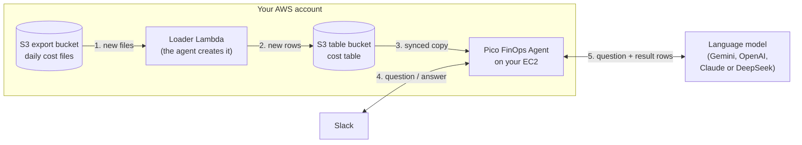

# Pico FinOps Agent: Setup Guide

**What you get:** a Slack assistant that answers questions about your AWS costs, and posts a short summary
twice a day with anything that changed.

> **@Pico FinOps Agent** what did I spend on AWS in October?
> **@Pico FinOps Agent** which service grew the most this week?

**Where it runs:** on one small EC2 server in **your own AWS account**. Your cost data stays in your account.
Nothing is sent to Pico FinOps or CloudPi.

**Time needed:** about 45 minutes of work. AWS can take up to 24 hours to deliver the first cost files.

---

## Contents

1. [How it works (2-minute read)](#1-how-it-works)
2. [Before you start](#2-before-you-start)
3. [Your setup worksheet](#3-your-setup-worksheet)
4. [Setup, step by step](#4-setup-step-by-step)
   - Part A, AWS: [Step 1](#step-1-turn-on-the-aws-cost-export) · [Step 2](#step-2-create-two-storage-buckets) · [Step 3](#step-3-create-the-two-permission-roles)
   - Part B, keys: [Step 4](#step-4-get-a-language-model-api-key) · [Step 5](#step-5-create-the-slack-app)
   - Part C, server: [Step 6](#step-6-launch-the-ec2-server) · [Step 7](#step-7-configure-and-start-the-agent) · [Step 8](#step-8-confirm-it-works)
5. [Using the agent](#5-using-the-agent)
6. [Troubleshooting](#6-troubleshooting)
7. [Updating, stopping and removing](#7-updating-stopping-and-removing)
8. [Security summary](#8-security-summary)

---

## 1. How it works

There are three parts:

| Part | What it does | Where it runs |
|---|---|---|
| **Cost data** | AWS writes your daily cost file (the **FOCUS** export) into an S3 bucket. | Your AWS account |
| **The agent** | Twice a day it loads the new cost files and keeps a fast copy of them. It answers questions and posts summaries. | One Docker container on your EC2 server |
| **Slack + the language model** | People ask questions in Slack. A language model (LLM) such as Google Gemini turns each question into a query and writes the answer. | Slack, and the LLM provider you choose |

### The daily flow



In plain words:

1. **Every day**, AWS writes your cost data into the export bucket.
2. **At 06:00 and 18:00 UTC**, the agent runs its loader. The loader reads only the new files and adds them to the cost table.
3. The agent copies the new rows to its server and **posts a 📊 summary in Slack**.
4. **When someone asks a question**, the agent sends the question to the LLM. It runs the query the LLM writes on its own copy of the data, then posts the answer in Slack.

### What leaves your AWS account

| Data | Where it goes |
|---|---|
| Your full cost data | **Stays in your AWS account** |
| AWS credentials | **No access keys are created.** The agent uses IAM roles. |
| One question and the few rows that answer it | Sent to your LLM provider to write the answer |
| Answers and summaries | Posted to your Slack |
| Anything to Pico FinOps / CloudPi | **Nothing** |

The server opens **no inbound ports**. It only makes outgoing HTTPS connections to AWS, Slack and your LLM provider.

---

## 2. Before you start

| You need | Why |
|---|---|
| **Admin access to the AWS account** (for this one-time setup) | To create the buckets, the roles and the server |
| **A Slack workspace where you can create apps** | So the agent can answer in Slack |
| **An API key for one LLM**: Google Gemini (default), OpenAI, Anthropic Claude or DeepSeek | To understand questions and write answers |
| **A web browser.** That's all you need on your computer. | You run all commands in AWS **CloudShell** (step 3) and on the EC2 server (step 7). You don't install anything locally. |

**Pick one AWS Region** (for example `us-east-1`) and use it for **everything**: the buckets, the server, and CloudShell.

---

## 3. Your setup worksheet

As you go, you'll collect the values below. Copy this table into a note and fill it in. In step 7 you paste these
values into the agent's settings file.

| # | Value | Example | You get it in |
|---|---|---|---|
| 1 | AWS Region | `us-east-1` | Your choice (section 2) |
| 2 | Export bucket | `acme-cost-export` | Step 1 |
| 3 | Export prefix (ends with `data/`) | `focus/acme-focus-export/data/` | Step 1 |
| 4 | Table bucket ARN | `arn:aws:s3tables:us-east-1:111122223333:bucket/acme-cost-agent` | Step 2 |
| 5 | State bucket | `acme-cost-agent-state` | Step 2 |
| 6 | Loader role ARN | `arn:aws:iam::111122223333:role/pico-finops-agent-loader-role` | Step 3 |
| 7 | LLM API key | `AIza…` | Step 4 |
| 8 | Slack app token | `xapp-…` | Step 5 |
| 9 | Slack bot token | `xoxb-…` | Step 5 |

> Treat items 7-9 like passwords. Keep them out of email and chat.

---

## 4. Setup, step by step

Each step tells you **what to do** and then how to **check it**. Don't move on until the check passes.

### Part A: Prepare AWS

---

### Step 1: Turn on the AWS cost export

**Goal:** AWS writes your cost data into an S3 bucket every day.

1. In the AWS Console, open **Billing and Cost Management → Data Exports → Create**.
2. **Export type:** choose **FOCUS 1.2** (with AWS columns).
3. **Export name:** for example `acme-focus-export`.
4. **Data export storage settings:** create or choose an S3 bucket (for example `acme-cost-export`) and a
   path prefix (for example `focus`).
   **File versioning:** either choice works. "Create new data export file" and "Overwrite existing data export
   file" are both loaded.
5. Click **Create**.

**Write down** (worksheet #2 and #3):
- **Export bucket:** `acme-cost-export`
- **Export prefix:** `<prefix>/<export-name>/data/`, for example `focus/acme-focus-export/data/`.
  It must end with `data/`.

**Check:** the export shows in the Data Exports list. The first files arrive **within 24 hours**. You can carry on
with the next steps in the meantime.

---

### Step 2: Create two storage buckets

**Goal:** a place for the agent's cost table, and a place for its small progress file.
Create both in **your chosen Region**.

**2a. Table bucket** (holds the cost table)
1. Open **S3 → Table buckets → Create table bucket**.
2. Name it, for example `acme-cost-agent`, and create it.
3. Open the bucket and copy its **ARN** (worksheet #4). It looks like
   `arn:aws:s3tables:us-east-1:111122223333:bucket/acme-cost-agent`.

> If S3 asks you to turn on the **integration with AWS analytics services**, you can leave it off. The agent doesn't need it.

**2b. State bucket** (holds a small progress file)
1. Open **S3 → General purpose buckets → Create bucket**.
2. Name it, for example `acme-cost-agent-state`.
3. Leave **Block all public access** turned **on**, and create it.
4. Write down the name (worksheet #5).

**Check:** both buckets appear in S3, in the same Region.

---

### Step 3: Create the two permission roles

**Goal:** two IAM roles that let the agent work without any access keys.

| Role | Used by | Allowed to |
|---|---|---|
| `pico-finops-agent-loader-role` | The loader Lambda | Read your export; write the cost table and the progress file; write its own logs |
| `pico-finops-agent-ec2-role` | The agent on the EC2 server | Create and run **only** the loader Lambda; read the cost table and the progress file |

Neither role can reach anything else in your account.

**3a. Open CloudShell.** In the AWS Console, check that your Region is selected (top right). Then click the
**CloudShell** icon (`>_`) in the top bar. A terminal opens in your browser. It's already signed in, and the AWS CLI
is installed.

**3b. Enter your values.** Replace the example values with your own from the worksheet, then paste the whole block
into CloudShell:

```bash
export REGION=us-east-1                            # worksheet #1
export EXPORT_BUCKET=acme-cost-export              # worksheet #2
export EXPORT_PREFIX=focus/acme-focus-export/data/ # worksheet #3 (ends with data/)
export EXPORT_ROOT=${EXPORT_PREFIX%data/}          # the prefix without data/ (overwrite exports keep metadata/ here)
export TABLE_BUCKET=acme-cost-agent                # the table bucket's NAME (the last part of worksheet #4)
export STATE_BUCKET=acme-cost-agent-state          # worksheet #5
export ACCOUNT_ID=$(aws sts get-caller-identity --query Account --output text)
echo "Account: $ACCOUNT_ID  Region: $REGION"
```

> If CloudShell reconnects later, these values are lost. Paste the block again before you continue.

**3c. Download the permission files and fill in your values:**

```bash
git clone https://github.com/CloudpiAi/Pico.git pico-finops-agent
mkdir -p pico-iam && cp pico-finops-agent/policies/aws/*.json pico-iam/ && cd pico-iam

sed -i -e "s|<region>|$REGION|g" \
       -e "s|<account-id>|$ACCOUNT_ID|g" \
       -e "s|<export-bucket>|$EXPORT_BUCKET|g" \
       -e "s|<export-prefix>|$EXPORT_PREFIX|g" \
       -e "s|<export-root>|$EXPORT_ROOT|g" \
       -e "s|<table-bucket>|$TABLE_BUCKET|g" \
       -e "s|<state-bucket>|$STATE_BUCKET|g" \
       -e "s|<state-key>|pico-finops-agent/state.json|g" *.json

grep -l '<' *.json || echo "OK: all values filled in"
```

**Check:** the last line prints `OK: all values filled in`. If it prints a file name instead, that file still has
a `<placeholder>` in it. Check the values in 3b and run 3c again.

**3d. Create the loader role** (for the Lambda):

```bash
aws iam create-role --role-name pico-finops-agent-loader-role \
  --assume-role-policy-document file://loader-role-trust.json
aws iam put-role-policy --role-name pico-finops-agent-loader-role \
  --policy-name pico-finops-agent-loader --policy-document file://loader-role-policy.json
aws iam attach-role-policy --role-name pico-finops-agent-loader-role \
  --policy-arn arn:aws:iam::aws:policy/service-role/AWSLambdaBasicExecutionRole
```

**3e. Create the EC2 role and its instance profile** (for the agent):

> **Role vs. instance profile.** An EC2 server can't use an IAM role directly. The role goes inside an
> **instance profile**, and you attach the instance profile to the server. The commands below create both, with the
> same name, `pico-finops-agent-ec2-role`:
>
> | Name | What it is | Where you use it |
> |---|---|---|
> | `pico-finops-agent-ec2-role` (**role**) | Holds the permissions (`ec2-role-policy.json`) | You don't select it directly |
> | `pico-finops-agent-ec2-role` (**instance profile**) | A container that holds the role | You select it on the EC2 server in step 6 |
>
> In the AWS Console, the EC2 field is called **IAM instance profile** (or **IAM role** under
> **Actions → Security → Modify IAM role**). Both show the instance profile name.

```bash
aws iam create-role --role-name pico-finops-agent-ec2-role \
  --assume-role-policy-document file://ec2-role-trust.json
aws iam put-role-policy --role-name pico-finops-agent-ec2-role \
  --policy-name pico-finops-agent --policy-document file://ec2-role-policy.json
aws iam create-instance-profile --instance-profile-name pico-finops-agent-ec2-role
aws iam add-role-to-instance-profile --instance-profile-name pico-finops-agent-ec2-role \
  --role-name pico-finops-agent-ec2-role
```

**3f. Copy the loader role's ARN** (worksheet #6):

```bash
aws iam get-role --role-name pico-finops-agent-loader-role --query Role.Arn --output text
```

**3g. Check that the instance profile holds the EC2 role:**

```bash
aws iam get-instance-profile --instance-profile-name pico-finops-agent-ec2-role \
  --query 'InstanceProfile.Roles[].RoleName' --output text
```

**Check:**
- 3f prints an ARN like `arn:aws:iam::111122223333:role/pico-finops-agent-loader-role`.
- 3g prints `pico-finops-agent-ec2-role`. If it prints nothing, the role isn't in the instance profile yet. Run the
  last command of 3e again.

> **Is your export bucket encrypted with your own KMS key (SSE-KMS)?** Then also allow `kms:Decrypt` on that key for
> `pico-finops-agent-loader-role`. The default S3 encryption needs nothing extra.

---

### Part B: Get your keys

---

### Step 4: Get a language model API key

**Goal:** an API key so the agent can understand questions and write answers.

Choose **one** provider and create a key there:

| Provider | Get a key from | Settings name for the key |
|---|---|---|
| **Google Gemini** (default) | [Google AI Studio](https://aistudio.google.com/) | `GEMINI_API_KEY` |
| OpenAI | [platform.openai.com](https://platform.openai.com/api-keys) | `OPENAI_API_KEY` |
| Anthropic Claude | [console.anthropic.com](https://console.anthropic.com/) | `ANTHROPIC_API_KEY` |
| DeepSeek | [platform.deepseek.com](https://platform.deepseek.com/) | `DEEPSEEK_API_KEY` |

Write down the key (worksheet #7) and which provider it's for.

**Check:** you have one key and know its provider. Step 8 tests the key automatically.

---

### Step 5: Create the Slack app

**Goal:** a Slack bot that people can @mention or send direct messages to.

> **Skip this step if you don't want Slack.** The agent still loads the data, but nobody can ask it questions.

**5a. Create the app from a ready-made manifest** (this sets all the permissions in one go):

1. Go to **[api.slack.com/apps](https://api.slack.com/apps) → Create New App → From a manifest**.
2. Pick your workspace, choose **YAML**, and paste this:

   ```yaml
   display_information:
     name: Pico FinOps Agent
     description: Answers questions about your AWS costs
   features:
     app_home:
       messages_tab_enabled: true
       messages_tab_read_only_enabled: false
     bot_user:
       display_name: Pico FinOps Agent
       always_online: true
   oauth_config:
     scopes:
       bot:
         - chat:write
         - channels:history
         - groups:history
         - im:history
         - mpim:history
         - reactions:write
   settings:
     event_subscriptions:
       bot_events:
         - message.channels
         - message.groups
         - message.im
         - message.mpim
     socket_mode_enabled: true
     org_deploy_enabled: false
     token_rotation_enabled: false
   ```

3. Click **Next → Create**.

**5b. Get the app token** (worksheet #8):
1. In the app's settings, open **Basic Information → App-Level Tokens → Generate Token and Scopes**.
2. Name it `socket`, add the scope `connections:write`, and click **Generate**.
3. Copy the token. It starts with **`xapp-`**.

**5c. Install the app and get the bot token** (worksheet #9):
1. Open **Install App → Install to Workspace → Allow**.
2. Copy the **Bot User OAuth Token**. It starts with **`xoxb-`**.

**5d. Create the summary channel:**
1. In Slack, create a channel, for example **#pico-finops-agent**.
2. Invite the bot to it: `/invite @Pico FinOps Agent`.

**Check:** you have an `xapp-…` token and an `xoxb-…` token, and the bot is in the channel.

<details>
<summary>Prefer to set up the Slack app by hand instead of with a manifest?</summary>

1. **Create New App → From scratch**, name it **Pico FinOps Agent**.
2. **Socket Mode:** turn it on and create an app-level token with `connections:write` (`xapp-…`).
3. **OAuth & Permissions → Bot Token Scopes:** `chat:write`, `channels:history`, `groups:history`, `im:history`,
   `reactions:write`, and optionally `mpim:history`.
4. **Event Subscriptions:** turn it on. Under **Subscribe to bot events**, add `message.channels`, `message.groups`,
   `message.im`, and optionally `message.mpim`.
5. **App Home:** turn on the **Messages tab** and tick **Allow users to send messages**.
6. **Install App:** install it and copy the bot token (`xoxb-…`).

</details>

---

### Part C: Start the agent

---

### Step 6: Launch the EC2 server

**Goal:** a small Linux server that runs the agent.

1. Open **EC2 → Launch instance**, in **your chosen Region**.
2. Choose these settings:

   | Setting | Value |
   |---|---|
   | Name | `pico-finops-agent` |
   | Image | **Amazon Linux 2023** (x86_64) |
   | Instance type | **`t3.medium`** (2 vCPU, 4 GB) or larger |
   | Key pair | Your choice. You won't need it if you connect with Session Manager (see below). |
   | Security group | **No inbound rules.** The agent doesn't need any. |
   | Storage | 20 GB or more |
   | Advanced details → **IAM instance profile** | **`pico-finops-agent-ec2-role`**: the instance profile from step 3e |
   | Advanced details → **Metadata version** | **V2 only (token required)** |
   | Advanced details → **Metadata response hop limit** | **1** |

3. Click **Launch instance**.

> **Don't see `pico-finops-agent-ec2-role` in the IAM instance profile list?** The list shows instance profiles, not
> roles. Check step 3g, then click the refresh icon next to the list.
>
> **Already have a server running?** Attach the instance profile to it: select the instance, then
> **Actions → Security → Modify IAM role**, choose `pico-finops-agent-ec2-role`, and click **Update IAM role**.
> Or, in CloudShell:
> ```bash
> aws ec2 associate-iam-instance-profile --instance-id <instance-id> \
>   --iam-instance-profile Name=pico-finops-agent-ec2-role
> ```
>
> **Why hop limit 1?** It stops other containers on the server from using the agent's role. Some images default to 2,
> so set it explicitly. For a server that's already running:
> ```bash
> aws ec2 modify-instance-metadata-options --instance-id <instance-id> \
>   --http-tokens required --http-put-response-hop-limit 1
> ```

**How to connect to the server without opening a port:** use **AWS Systems Manager Session Manager**. Give the role
access to it once (in CloudShell):

```bash
aws iam attach-role-policy --role-name pico-finops-agent-ec2-role \
  --policy-arn arn:aws:iam::aws:policy/AmazonSSMManagedInstanceCore
```

Wait 2-3 minutes. Then select the instance in EC2, click **Connect → Session Manager → Connect**, and run `sudo su - ec2-user`.
(If you'd rather use SSH, add an inbound rule for port 22 from your own IP address only.)

**Install Docker** on the server. Paste this block:

```bash
sudo dnf install -y docker git
sudo systemctl enable --now docker
sudo mkdir -p /usr/local/lib/docker/cli-plugins
sudo curl -sSL https://github.com/docker/compose/releases/latest/download/docker-compose-linux-x86_64 \
  -o /usr/local/lib/docker/cli-plugins/docker-compose
sudo chmod +x /usr/local/lib/docker/cli-plugins/docker-compose
sudo usermod -aG docker $USER
```

Then **log out and connect again**, so you can use Docker without `sudo`.

**Check:**
- `docker compose version` prints a version number.
- The server is using the agent's role:
  ```bash
  TOKEN=$(curl -s -X PUT http://169.254.169.254/latest/api/token -H "X-aws-ec2-metadata-token-ttl-seconds: 60")
  curl -s -H "X-aws-ec2-metadata-token: $TOKEN" http://169.254.169.254/latest/meta-data/iam/security-credentials/
  ```
  This prints `pico-finops-agent-ec2-role`. If it prints nothing or an error, the instance profile isn't attached.
  See "Already have a server running?" above.

> Use this server **only** for the Pico FinOps Agent, and don't give other people logins on it.

---

### Step 7: Configure and start the agent

**Goal:** the agent is downloaded, configured with your worksheet values, and running.

**7a. Download the agent** (on the EC2 server). The repository holds the settings template and the compose file;
the image comes ready-made from the GitHub Container Registry (built and checked by this repository's GitHub
Actions, public, no login needed):

```bash
git clone https://github.com/CloudpiAi/Pico.git ~/pico-finops-agent
cd ~/pico-finops-agent
git checkout v0.2.0         # the latest release (Releases page)
docker compose pull         # ghcr.io/cloudpiai/pico-finops-agent
```

> **Prefer to build the image yourself?** Everything that runs is in this repository. Instead of `docker compose
> pull`, run `docker compose -f docker-compose.yml -f docker-compose.build.yml build` (a few minutes), and add
> the same two `-f` options to every `docker compose` command below.

**7b. Create the settings file:**

```bash
umask 077
cp .env.example .env
nano .env
```

Change these lines to your worksheet values. Leave the other lines as they are.

| Line in `.env` | Value |
|---|---|
| `FOCUS_REGION=` | worksheet #1 |
| `FOCUS_EXPORT_BUCKET=` | worksheet #2 |
| `FOCUS_EXPORT_PREFIX=` | worksheet #3 (ends with `data/`) |
| `FOCUS_TABLE_BUCKET_ARN=` | worksheet #4 |
| `FOCUS_STATE_BUCKET=` | worksheet #5 |
| `FOCUS_LAMBDA_ROLE_ARN=` | worksheet #6 |
| `GEMINI_API_KEY=` | worksheet #7, if you use Gemini |
| `SLACK_APP_TOKEN=` | worksheet #8. Remove the `#` at the start of the line |
| `SLACK_BOT_TOKEN=` | worksheet #9. Remove the `#` at the start of the line |
| `SLACK_NOTIFY_CHANNEL=` | `pico-finops-agent`. Remove the `#` at the start of the line |

**Using OpenAI, Claude or DeepSeek instead of Gemini?** Remove the `#` from `AGENT_LLM_PROVIDER` and from the
provider's key line, and set both. For example, for Claude:

```
AGENT_LLM_PROVIDER=anthropic
ANTHROPIC_API_KEY=<your key>
```

Save with **Ctrl+O, Enter**, then exit with **Ctrl+X**.

<details>
<summary>What a finished <code>.env</code> looks like (example values)</summary>

```bash
FOCUS_REGION=us-east-1
FOCUS_EXPORT_BUCKET=acme-cost-export
FOCUS_EXPORT_PREFIX=focus/acme-focus-export/data/
FOCUS_TABLE_BUCKET_ARN=arn:aws:s3tables:us-east-1:111122223333:bucket/acme-cost-agent
FOCUS_STATE_BUCKET=acme-cost-agent-state
FOCUS_LAMBDA_ROLE_ARN=arn:aws:iam::111122223333:role/pico-finops-agent-loader-role
GEMINI_API_KEY=AIza...
SLACK_APP_TOKEN=xapp-...
SLACK_BOT_TOKEN=xoxb-...
SLACK_NOTIFY_CHANNEL=pico-finops-agent
```

</details>

**7c. Run the pre-flight check.** It tests your AWS role, buckets, Slack tokens and LLM key. It posts nothing and
changes nothing.

```bash
docker compose run --rm agent check
```

Each line starts with `OK:` or `ALERT:`. An `ALERT:` line names the setting or permission to fix. Fix it in `.env`,
then run the check again.

**Check:** the last line says **`All checks passed.`**

> **First time?** You'll see `OK: AWS: nothing loaded yet (the first start loads every month)`. That's expected.
> If AWS hasn't delivered the first cost files yet (step 1 was less than 24 hours ago), start the agent anyway: it
> loads them on its next scheduled run after they arrive, or right away if you ask it `set up the cost agent`.

**7d. Start the agent:**

```bash
docker compose up -d
docker logs -f pico-finops-agent       # watch the first start; press Ctrl+C to stop watching (the agent keeps running)
```

On its first start the agent sets itself up:
1. It creates its loader Lambda and the cost table.
2. It loads your cost months and builds its local copy.
3. It posts a 📊 message in `#pico-finops-agent`.

This takes a few minutes, or longer if you have many months of data.

---

### Step 8: Confirm it works

| Check | How | Expected |
|---|---|---|
| The agent is running | `docker compose ps` | Status **healthy** |
| Data has loaded | Look in `#pico-finops-agent` | A 📊 **Fresh cost data is in…** message |
| The bot answers | In Slack: `@Pico FinOps Agent what did I spend this month?` | An answer within about a minute |

**Setup is complete.** 🎉

---

## 5. Using the agent

**Ask questions:** @mention the bot in a channel it's in, or send it a direct message.

- `@Pico FinOps Agent what did I spend on AWS in October?`
- `@Pico FinOps Agent top 5 services this month`
- `@Pico FinOps Agent why did EC2 cost go up yesterday?`
- `@Pico FinOps Agent when was the cost data last updated?`
- `@Pico FinOps Agent set up the cost agent` (loads the newest data right now)

**Automatic messages** in `#pico-finops-agent`:

| Message | When it appears |
|---|---|
| 📊 **Fresh cost data is in…** | After new data loads: yesterday vs. usual, month so far, sudden increases, new resources |
| ⚠️ **I couldn't refresh the cost data: …** | Something broke. The message says what to fix. It's sent once per problem. |
| ✅ **Cost data is refreshing again** | The problem is fixed |
| ⚠️ **No new AWS cost data for N days** | The AWS export may have stopped |

**Optional settings** (in `.env`; after changing one, run `docker compose up -d`):

| Setting | Default | What it changes |
|---|---|---|
| `FOCUS_SCHEDULE` | `0 6,18 * * *` | When data loads (cron, UTC) |
| `FOCUS_MONTHS` | `4` | How many months of cost data to keep |
| `FOCUS_ALERT_INCREASE_PCT` | `50` | How big a jump counts as a "sudden increase" (% above the 7-day average) |
| `FOCUS_ALERT_STALE_DAYS` | `3` | After how many days without new data it warns you |
| `AGENT_LLM_MODEL` | Provider default | Choose a specific model, e.g. `gpt-5.4-mini` |

The default models are `gemini-3.8-flash`, `gpt-5.5`, `claude-sonnet-4-6` and `deepseek-v4-pro`.

---

## 6. Troubleshooting

The agent tells you in Slack (and in `docker logs`) what's wrong. Find the message below:

| You see | What to do |
|---|---|
| "the EC2 role isn't allowed to …" | Re-apply `ec2-role-policy.json` to `pico-finops-agent-ec2-role` (step 3e) |
| "the loader Lambda's role isn't allowed to …" | Re-apply `loader-role-policy.json` to `pico-finops-agent-loader-role` (step 3d) |
| "the loader Lambda's role is missing or can't be used" | Recreate the role exactly as in step 3d, and check `FOCUS_LAMBDA_ROLE_ARN` |
| "the state bucket doesn't exist" | Create it (step 2b), or fix `FOCUS_STATE_BUCKET` in `.env` |
| "the EC2 has no working AWS credentials" | The instance profile isn't attached. Attach the `pico-finops-agent-ec2-role` instance profile: **EC2 → Actions → Security → Modify IAM role** (step 6). Check that hop limit is 1 and IMDSv2 is required |
| `FOCUS_… is not set` when the agent starts | That line is missing or empty in `.env`. Fix it and run `docker compose up -d` |
| "No new AWS cost data for N days" | Check **Billing and Cost Management → Data Exports**. The export may be paused or deleted. |
| The bot doesn't answer | Check that the bot is in the channel and that you @mention it. Then run `docker logs --tail 50 pico-finops-agent` |
| **unhealthy**: "Slack tokens rejected" | A Slack token is wrong or revoked. Fix `SLACK_APP_TOKEN` / `SLACK_BOT_TOKEN`, then `docker compose up -d` |
| **unhealthy**: "Slack unreachable" / "disconnected" | Usually a network problem or a Slack outage. The agent retries, and restarts itself after 10 minutes. |

IAM changes can take a few minutes to apply. The agent retries on its next run, or ask it `set up the cost agent`.

**Useful commands** (run them in `~/pico-finops-agent`):

```bash
docker compose ps                          # running? healthy?
docker logs --tail 50 pico-finops-agent    # recent activity and errors
docker compose run --rm agent check        # re-run the pre-flight check (posts nothing)
docker compose restart                     # restart the agent
docker inspect pico-finops-agent --format '{{json .State.Health.Log}}' | tail -c 400   # the last health check result
```

**Still stuck?** Open an issue at [github.com/CloudpiAi/Pico/issues](https://github.com/CloudpiAi/Pico/issues) and
attach the output of `docker logs --tail 100 pico-finops-agent`. The agent never prints your keys or tokens, but
please read the output before you share it.

---

## 7. Updating, stopping and removing

**Update to a new version** (your data is kept). Read the release's notes on the
[Releases page](https://github.com/CloudpiAi/Pico/releases) first: they list any new setting or permission.

```bash
cd ~/pico-finops-agent
git fetch --tags
git checkout v0.2.0         # the release you want
docker compose pull         # if you pin AGENT_IMAGE_TAG in .env, set it to the same version first
docker compose run --rm agent check
docker compose up -d
```

Building it yourself: replace `docker compose pull` with
`docker compose -f docker-compose.yml -f docker-compose.build.yml build`, and keep the two `-f` options on the
other commands.

**Stop:**

```bash
docker compose down         # stop, and keep the local data
docker compose down -v      # stop, and delete the local data (it's rebuilt from S3 on the next start)
```

**Remove everything:** stop the agent, terminate the EC2 instance, then delete these in AWS:
- the Lambda function `pico-finops-agent-loader` and the layer `pico-finops-agent-duckdb`
- the roles `pico-finops-agent-loader-role` and `pico-finops-agent-ec2-role`, and the instance profile `pico-finops-agent-ec2-role`
- the table bucket and the state bucket
- the cost export, if you no longer need it

---

## 8. Security summary

- **Your data stays in your account.** Only a question and the few rows that answer it go to your LLM provider. Answers go to your Slack.
- **No inbound connections.** The server opens no ports. It connects out to AWS, Slack and the LLM only. Setup and
  updates also download from GitHub (`github.com`, and the image from `ghcr.io` / `pkg-containers.githubusercontent.com`);
  building the image yourself also downloads from Docker Hub, PyPI and `extensions.duckdb.org`.
- **No AWS access keys.** The agent uses two IAM roles, and each role can reach only the agent's own resources.
- **Hardened container.** It runs as a normal user, on a read-only file system, with all Linux capabilities dropped.
- **Keep `.env` private.** It holds your LLM key and Slack tokens. Step 7b creates it readable by you only.
